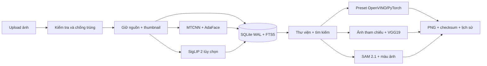

# Kiến trúc LumaNest

## Pipeline

FastAPI cung cấp API và static frontend. SQLite lưu metadata, embedding, tác vụ và lịch sử; ảnh/model nằm trên filesystem. Queue tách công việc nền, lưu tiến độ sau từng ảnh, chống gửi lặp và hỗ trợ tiếp tục lô.

MTCNN phát hiện mặt → alignment 5 điểm → AdaFace tạo vector đã normalize → cosine retrieval. Kết quả là độ tương đồng, không phải xác suất hay danh tính đã xác nhận.

Preset Fast Neural Style chạy một lượt, CPU dùng OpenVINO hoặc PyTorch. Style bất kỳ dùng VGG19 cố định backbone, L-BFGS cập nhật pixel ảnh đầu ra (256 px rồi 512 px). Mỗi lần cập nhật là một bước tối ưu, không phải một ảnh mới.

Qwen chạy qua llama.cpp loopback, không có tool truy cập ảnh/filesystem. Gemini, OpenAI và API tương thích nhận văn bản hội thoại; công thức được kiểm tra schema trước khi tạo. Với Qwen, ảnh nguồn được NST cục bộ và API (nếu có) chỉ tạo ảnh tham chiếu từ văn bản. Khi người dùng chọn model API, ảnh nguồn thu nhỏ tối đa 1536 px được gửi tới nhà cung cấp để model ảnh vẽ lại (chế độ edit), hoặc model vision mô tả cảnh rồi model ảnh vẽ lại (chế độ redraw).

## Cấu trúc

| Thành phần | Đường dẫn |
|---|---|
| Backend, model adapters, storage | `fsmart/` |
| Giao diện | `fsmart/static/` |
| Launcher Windows có thể build lại | `desktop/` |
| Cài đặt, tải model, đóng gói | `scripts/` |
| Kiểm thử dùng dữ liệu tạm | `tests/` |
| Dữ liệu cá nhân, ngoài Git | `runtime/` |
| Model, ngoài Git | `weights/` |

Tên package nội bộ `fsmart` và biến `FSM_*` được giữ để tương thích thư viện hiện có. Đổi thương hiệu không chuyển hoặc xóa album, ảnh hay embedding. Hệ thống chưa có đồng bộ đám mây, tài khoản nhiều người hoặc API công khai.
